# TameerAI — Entity-Relationship Design & Architecture (Phase 01C.1)

**Project:** TameerAI Construction Compliance & Cost Intelligence  
**Document:** Entity-Relationship Diagram and Relational Linkages  
**Revision:** Post-Audit Corrected Version (19 Tables Reconciled)

---

## 1. High-Level Entity Overview (19 Tables)

The schema is structured into 5 logical clusters encompassing exactly **19 relational tables**:
1. **Identity & Administration Cluster (3 tables):** `users`, `user_settings`, `user_sessions`.
2. **Project Workspace Cluster (4 tables):** `projects`, `project_members`, `project_activities`, `documents`.
3. **Conversational AI Cluster (2 tables):** `chat_sessions`, `chat_messages`.
4. **Engineering Intelligence Cluster (8 tables):**
   - Compliance: `compliance_audits`, `compliance_findings`.
   - Contract Risk: `contract_analyses`, `contract_risk_cards`.
   - Cost & BOQ: `material_rates`, `boq_analyses`, `boq_items`.
   - Consulting Reports: `reports`.
5. **RAG Vector Knowledgebase Cluster (2 tables):** `knowledge_sources`, `document_chunks`.

---

## 2. Mermaid Entity-Relationship Diagram

```mermaid
erDiagram
    users ||--|| user_settings : "configures (1:1)"
    users ||--o{ user_sessions : "authenticates (1:N)"
    users ||--o{ projects : "owns (1:N)"
    users ||--o{ project_members : "participates_in (1:N)"
    users ||--o{ chat_sessions : "initiates (1:N)"
    users ||--o{ compliance_audits : "runs (1:N)"
    users ||--o{ contract_analyses : "evaluates (1:N)"
    users ||--o{ boq_analyses : "calculates (1:N)"
    users ||--o{ reports : "generates (1:N)"

    projects ||--o{ project_members : "has (1:N)"
    projects ||--o{ project_activities : "logs (1:N)"
    projects ||--o{ documents : "contains (1:N)"
    projects ||--o{ chat_sessions : "references (0..1:N)"
    projects ||--o{ compliance_audits : "audits (1:N)"
    projects ||--o{ contract_analyses : "assesses (1:N)"
    projects ||--o{ boq_analyses : "forecasts (1:N)"
    projects ||--o{ reports : "produces (1:N)"
    projects ||--o{ document_chunks : "isolates (0..1:N)"

    documents ||--o{ compliance_audits : "inspected_by"
    documents ||--o{ contract_analyses : "analyzed_by"
    documents ||--o{ boq_analyses : "parsed_for"
    documents ||--o{ document_chunks : "chunked_into"

    chat_sessions ||--o{ chat_messages : "contains (1:N)"

    compliance_audits ||--o{ compliance_findings : "identifies (1:N)"
    contract_analyses ||--o{ contract_risk_cards : "flags (1:N)"
    boq_analyses ||--o{ boq_items : "itemizes (1:N)"

    knowledge_sources ||--o{ document_chunks : "originates (1:N)"

    users {
        UUID id PK
        VARCHAR email UK
        VARCHAR hashed_password
        VARCHAR full_name
        VARCHAR role
        VARCHAR company
        VARCHAR pec_number
        VARCHAR city
        TIMESTAMPTZ created_at
    }

    user_settings {
        UUID id PK
        UUID user_id FK,UK "Strict 1:1"
        VARCHAR language
        VARCHAR theme
        BOOLEAN pbc_violations_alert
        BOOLEAN fidic_risks_alert
        VARCHAR ai_strictness
    }

    user_sessions {
        UUID id PK
        UUID user_id FK
        VARCHAR refresh_token_hash
        VARCHAR device_info
        VARCHAR ip_address
        TIMESTAMPTZ expires_at
        TIMESTAMPTZ created_at
    }

    projects {
        UUID id PK
        VARCHAR code "UK per user (e.g. PRJ-001)"
        UUID user_id FK "Owner"
        VARCHAR name
        VARCHAR name_urdu
        VARCHAR location
        VARCHAR city
        VARCHAR type
        NUMERIC budget_crore
        NUMERIC budget_raw
        NUMERIC spent_crore
        VARCHAR status
        VARCHAR risk
        INTEGER compliance_score
    }

    project_members {
        UUID id PK
        UUID project_id FK
        UUID user_id FK
        VARCHAR role "owner, lead_engineer, architect, contractor, viewer"
        TIMESTAMPTZ created_at
    }

    project_activities {
        UUID id PK
        UUID project_id FK
        UUID user_id FK
        VARCHAR action
        VARCHAR details
        TIMESTAMPTZ created_at
    }

    documents {
        UUID id PK
        VARCHAR code "UK per project (e.g. DOC-01)"
        UUID project_id FK
        UUID user_id FK
        VARCHAR name
        VARCHAR file_type
        BIGINT file_size_bytes
        VARCHAR status
        VARCHAR storage_path
    }

    chat_sessions {
        UUID id PK
        VARCHAR code "e.g. session-1"
        UUID user_id FK
        UUID project_id FK "Nullable"
        VARCHAR title
        VARCHAR title_urdu
        VARCHAR type
    }

    chat_messages {
        UUID id PK
        VARCHAR code "e.g. msg-1"
        UUID session_id FK
        VARCHAR role
        TEXT content
        TEXT content_urdu
        JSONB warning_card
        JSONB citations
    }

    compliance_audits {
        UUID id PK
        UUID project_id FK
        UUID document_id FK "Nullable"
        UUID user_id FK
        INTEGER overall_score
        INTEGER total_checks
        INTEGER passed_count
        INTEGER warning_count
        INTEGER violation_count
    }

    compliance_findings {
        UUID id PK
        VARCHAR code "UK per audit (e.g. RULE-001)"
        UUID audit_id FK
        UUID project_id FK
        VARCHAR category
        VARCHAR title
        VARCHAR status
        VARCHAR required_value
        VARCHAR current_value
        VARCHAR reference_code
        VARCHAR reference_clause
        NUMERIC pin_x
        NUMERIC pin_y
    }

    contract_analyses {
        UUID id PK
        UUID project_id FK
        UUID document_id FK "Nullable"
        UUID user_id FK
        VARCHAR contract_title
        NUMERIC risk_score
        VARCHAR risk_category
    }

    contract_risk_cards {
        UUID id PK
        VARCHAR code "UK per analysis (e.g. RISK-001)"
        UUID analysis_id FK
        VARCHAR clause_title
        VARCHAR fidic_reference
        INTEGER page_number
        VARCHAR risk_level
        TEXT explanation
        TEXT recommendation
    }

    material_rates {
        UUID id PK
        VARCHAR city
        VARCHAR name
        VARCHAR unit
        NUMERIC rate_pkr
        NUMERIC change_pct
        VARCHAR trend
        DATE recorded_date
    }

    boq_analyses {
        UUID id PK
        UUID project_id FK
        UUID user_id FK
        NUMERIC project_budget
        NUMERIC estimated_cost
        NUMERIC cost_variance
        NUMERIC variance_percentage
        VARCHAR risk_indicator
    }

    boq_items {
        UUID id PK
        UUID analysis_id FK
        VARCHAR phase
        VARCHAR item_code
        TEXT description
        NUMERIC quantity
        NUMERIC boq_base_rate
        NUMERIC current_price
        NUMERIC overrun_amount
    }

    reports {
        UUID id PK
        VARCHAR code "UK per project (e.g. RPT-001)"
        UUID project_id FK
        UUID user_id FK
        VARCHAR title
        VARCHAR category
        VARCHAR status
        INTEGER page_count
        VARCHAR file_path
    }

    knowledge_sources {
        UUID id PK
        VARCHAR title
        VARCHAR short_code UK
        VARCHAR jurisdiction
        VARCHAR authority
        VARCHAR version
        BOOLEAN is_official_regulatory
    }

    document_chunks {
        UUID id PK
        UUID knowledge_source_id FK "Nullable (Global)"
        UUID project_document_id FK "Nullable (Private)"
        UUID project_id FK "Nullable (Private)"
        VARCHAR chapter
        VARCHAR section
        INTEGER page_number
        TEXT content
        TEXT content_urdu
        vector embedding "Parameterized Dimension"
    }
```

---

## 3. Relational Cardinality & Integrity Rules

### 3.1 Strict 1:1 Relationship: `users` to `user_settings`
Each user has exactly **one** settings record. This is strictly enforced at the database level:
- `user_settings.user_id` has a unique constraint: `UNIQUE(user_id)`.
- Foreign key: `FOREIGN KEY (user_id) REFERENCES users(id) ON DELETE CASCADE`.
- Creation: Automatically provisioned via trigger or application logic when a new user registers.

### 3.2 Dual Identifier Pattern (`UUID` + `code`)
All primary keys in PostgreSQL are immutable, collision-free `UUID`s generated by `gen_random_uuid()`. To preserve frontend routes (`/projects/PRJ-001`, `/documents/DOC-01`, etc.):
- Human-readable identifiers are stored in a dedicated `code VARCHAR(50)` column.
- Uniqueness is scoped logically:
  - Projects: `UNIQUE(user_id, code)` — User A and User B can each have `PRJ-001` without collision.
  - Documents: `UNIQUE(project_id, code)` — Clean scoping inside a project workspace.
  - Findings / Risk Cards: `UNIQUE(audit_id, code)` / `UNIQUE(analysis_id, code)`.
- Backend Pydantic models serialize `code` into the frontend's expected `id` field.

### 3.3 Relational Cascades and Deletion Rules

| Parent Table | Child Table | Foreign Key Column | On Delete Action | Justification |
| :--- | :--- | :--- | :--- | :--- |
| `users` | `projects` | `user_id` | **RESTRICT** | Prevents accidental deletion of commercial engineering projects containing historical legal or audit records. |
| `users` | `user_settings` | `user_id` | **CASCADE** | Deleting a user cleanly removes profile preferences. |
| `users` | `user_sessions` | `user_id` | **CASCADE** | Deleting a user invalidates all active device sessions. |
| `projects` | `documents` | `project_id` | **CASCADE** | Deleting a project removes its attached blueprints and submittals. |
| `projects` | `project_members` | `project_id` | **CASCADE** | Deleting a project removes member permission grants. |
| `projects` | `project_activities`| `project_id` | **CASCADE** | Deleting a project clears its activity audit trail. |
| `projects` | `compliance_audits` | `project_id` | **CASCADE** | Audits belong to a project lifecycle. |
| `compliance_audits` | `compliance_findings` | `audit_id` | **CASCADE** | Deleting an audit deletes its rule findings. |
| `projects` | `contract_analyses` | `project_id` | **CASCADE** | Project deletion clears contract analyses. |
| `contract_analyses` | `contract_risk_cards` | `analysis_id` | **CASCADE** | Analysis deletion clears risk cards. |
| `projects` | `boq_analyses` | `project_id` | **CASCADE** | Project deletion clears BOQ overruns. |
| `boq_analyses` | `boq_items` | `analysis_id` | **CASCADE** | Analysis deletion clears itemized lines. |
| `projects` | `reports` | `project_id` | **CASCADE** | Deleting a project clears report records. |
| `chat_sessions` | `chat_messages` | `session_id` | **CASCADE** | Deleting a conversation deletes all messages within. |
| `projects` | `chat_sessions` | `project_id` | **SET NULL** | Project deletion unlinks chat sessions without deleting the user's conversation history. |
| `knowledge_sources` | `document_chunks` | `knowledge_source_id` | **CASCADE** | Re-indexing a regulatory source cleanly replaces its vector chunks. |
| `documents` | `document_chunks` | `project_document_id` | **CASCADE** | Deleting a user blueprint deletes its private vector chunks. |
| `projects` | `document_chunks` | `project_id` | **CASCADE** | Deleting a project deletes all private vector chunks. |
